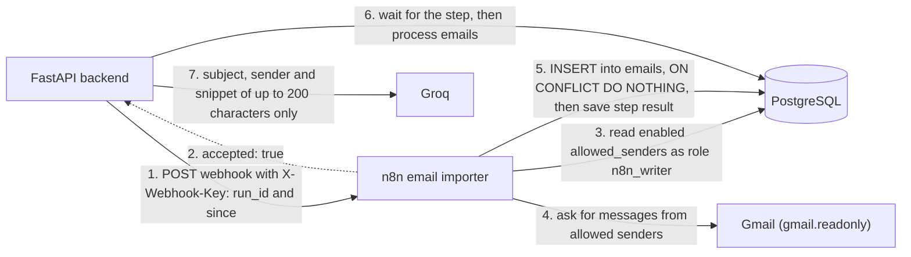

# AI Job Tracker

A personal web app that automatically searches for remote jobs (as far as each site allows), tracks job applications, and monitors job-related Gmail messages. It is built for personal use and as a portfolio project.

> **Status:** The backend is complete through phase P11c. The frontend is postponed. There is no UI yet: use `curl`, `psql` and `pytest`.

## Hard rules

- **No auto-submit.** The app never submits a job application. Opening a listing does not mean "applied". The app asks "Did you apply?" and only you confirm.
- **Gmail is read-only.** The Gmail credential has the `gmail.readonly` scope only. Only allowlisted senders (exact email addresses) are read. Original emails are never changed.
- **The AI sees very little.** For emails, only the subject, the sender and a snippet of at most 200 characters can go to the AI. The email body never does.
- **The AI never takes actions and never invents facts.** It only uses your stored profile. The code decides everything.
- **In-app notifications only.** Follow-ups are a simple to-do list.
- **No secrets in the repository.** Credentials live in git-ignored env files.
- **Zero-cost tooling.** Only free tools and services are used.

## Architecture

Stack: Python, FastAPI, SQLAlchemy 2, Alembic, PostgreSQL, Groq free tier (`openai/gpt-oss-20b`). n8n is used as the email importer only.

n8n has no business logic. It does not call the API back. It uses its own limited database role (`n8n_writer`) and a Gmail credential that can only read.



The role `n8n_writer` cannot read `jobs`, cannot read the subject, snippet or HTML of `emails`, and cannot update or delete `emails`. Both n8n workflows are exported with execution data saving turned off.

## Getting jobs

What is built and what is not:

| Way | Status |
| --- | --- |
| Job feeds (We Work Remotely, RemoteOK, Remotive) | Built |
| LinkedIn job-alert emails (through email sync) | Built |
| Manual `POST /jobs` (source `manual`, API only) | Built |
| AI-assisted draft (`POST /jobs/extract`, API only, does not save) | Built |
| "+ Add Job" form | Planned only (the frontend is postponed) |
| Chrome extension | Planned only (`extension` is an accepted source value, but no extension exists) |

Feeds in the code:

- `weworkremotely`: three category RSS feeds (customer support, programming, all other), fetched in one step per hunt. See "Source terms".
- `remoteok`: the RemoteOK API.
- `remotive`: the Remotive API. See "Source terms".

## Repository layout

- `backend/` - FastAPI app, models, services, Alembic migrations, tests
- `scripts/` - `seed.sql`, `set_profile.py`, `n8n_writer.sql`, `smoke_api.sh`, `smoke.sh`, `backup_check.sh`
- `n8n/` - the two exported n8n workflows
- `docker-compose.yml` - the PostgreSQL container
- `n8n-compose.yml` - the n8n container
- `PRIVACY.md` - privacy policy
- `docs/` - empty placeholder

## Setup

Env files (all git-ignored; the `.example` files list the variable names):

| File | Contents |
| --- | --- |
| `.env` | PostgreSQL settings only: `POSTGRES_DB`, `POSTGRES_USER`, `POSTGRES_PASSWORD`. Docker Compose passes this whole file to the database container. |
| `groq.env` | `GROQ_API_KEY` only. Never passed to a container. |
| `app.env` | Backend-only values: `API_KEY`, `N8N_WRITER_PASSWORD`, `GROQ_MOCK`, `N8N_WEBHOOK_URL`, `N8N_WEBHOOK_KEY`. |
| `n8n.env` | n8n container settings, including `N8N_ENCRYPTION_KEY`. Keep a backup of that key in a password manager. |
| `n8n-webhook.env` | Optional local reference copy of the webhook path and key for n8n setup. Git-ignored and not read by the app. |

`N8N_WEBHOOK_URL` is the full production URL of the n8n webhook, including `http://` and the secret path. `N8N_WEBHOOK_KEY` is the value of the webhook header. Never commit real values or paste them anywhere public.

Create the env files and install the backend:

```bash
cp .env.example .env
cp groq.env.example groq.env
cp app.env.example app.env
cp n8n.env.example n8n.env
chmod 600 .env groq.env app.env n8n.env
python3 -m venv backend/.venv
source backend/.venv/bin/activate
pip install -r backend/requirements.txt
```

Database and API (from the repository root):

```bash
sudo docker start jobtracker-postgres
cd backend
source .venv/bin/activate
alembic upgrade head
uvicorn app.main:app --host 127.0.0.1 --port 8000 --workers 1
```

Use `--workers 1`. The scheduler and the orphaned-run cleanup assume a single worker. Settings are read once when the API starts, so restart the API after editing any env file. Run migrations on the real database with plain `alembic upgrade head`. Do not run downgrades on the real database.

The current Alembic head is `0005`.

Default data: `scripts/seed.sql` inserts the sources, default settings, an empty profile row and a starter allowed sender. It is safe to run again.

The limited n8n role: `scripts/n8n_writer.sql` creates the role `n8n_writer` and its grants. It reads the password from the `N8N_WRITER_PASSWORD` environment variable of the `psql` process (`\getenv`). It is not part of Alembic. Run it again after any database rebuild.

n8n (email importer only):

1. Start the container defined in `n8n-compose.yml` (it listens on `127.0.0.1:5679` only).
2. Import both workflows from `n8n/`. The exports contain a placeholder webhook path and no credential ids, so some manual setup is needed after import.
3. Create the credentials in n8n: a PostgreSQL credential for the role `n8n_writer`, a Gmail OAuth2 credential with the `gmail.readonly` scope only, and a Header Auth credential for the webhook (header name `X-Webhook-Key`).
4. Set the real webhook path in the Webhook node and attach the error handler workflow to the importer in its workflow settings (the exported JSON has no link between them).
5. Publish the importer, then put the production webhook URL and key in `app.env` and restart the API.

Gmail OAuth app: the Google OAuth app is set to "In production" and has not been submitted for Google verification. Whether the Gmail refresh token still expires after about 7 days is **not yet verified**. If email sync starts failing, check the Gmail credential in n8n.

API docs pages are disabled (`/docs`, `/redoc` and `/openapi.json` return nothing). Every endpoint except `GET /health` needs the `X-API-Key` header and returns `401` with `Invalid or missing API key` otherwise.

## Settings

Environment variables with defaults (optional):

| Variable | Default |
| --- | --- |
| `POSTGRES_HOST` | `127.0.0.1` |
| `POSTGRES_PORT` | `5433` |
| `GROQ_MODEL` | `openai/gpt-oss-20b` |
| `GROQ_REASONING_EFFORT` | `low` |
| `SCORE_INTERVAL_SECONDS` | `12.0` |
| `SCHEDULER_THREAD_ENABLED` | `true` |
| `CORS_ORIGINS` | `["http://localhost:5173", "http://127.0.0.1:5173"]` (a JSON list) |
| `GROQ_MOCK` | `false` |

Runtime settings are stored in the database and changed with `PATCH /settings`:

| Key | Default |
| --- | --- |
| `scheduler_enabled` | `false` |
| `hunt_interval_hours` | `6` |
| `score_interval_minutes` | `30` |
| `score_batch_limit` | `10` |
| `daily_score_cap` | `100` |
| `apply_threshold` | `70` |
| `maybe_threshold` | `40` |
| `followup_reminders_enabled` | `true` |
| `email_auto_status_enabled` | `true` |
| `email_auto_status_min_confidence` | `85` |
| `email_classify_daily_cap` | `30` |
| `email_sync_lookback_days` | `7` |
| `email_sync_timeout_seconds` | `300` |
| `email_sync_interval_minutes` | `120` |

`title_exclude_regex` and `title_include_keywords` also exist as settings and control the title filter before scoring.

## Scheduler

The scheduler is **off by default** (`scheduler_enabled` is `false`). When it is on, it runs hunts, scoring and email sync on their intervals. Follow-up reminders only use the database, so they run even when `scheduler_enabled` is `false`.

There are two separate switches. `SCHEDULER_THREAD_ENABLED` (environment variable, default `true`) decides whether the scheduler thread and the startup cleanup exist at all. `scheduler_enabled` (database setting) decides whether hunts, scoring and email sync actually run.

## API overview

All endpoints need `X-API-Key`, except `GET /health` (returns `{"status": "ok"}`, or `503` when the database is unreachable).

| Area | Endpoints |
| --- | --- |
| Jobs | `POST /jobs`, `POST /jobs/extract`, `GET /jobs`, `GET /jobs/{id}`, `PATCH /jobs/{id}`, `POST /jobs/{id}/open`, `POST /jobs/{id}/dismiss`, `POST /jobs/{id}/restore` |
| Hunts | `POST /hunts`, `GET /hunts`, `GET /hunts/{id}` |
| Sources | `GET /sources`, `PATCH /sources/{id}` |
| Scoring | `POST /score/run` |
| Settings | `GET /settings`, `PATCH /settings` |
| Notifications | `GET /notifications`, `PATCH /notifications/{id}` |
| Profile | `GET /profile`, `PUT /profile` |
| Resume draft | `POST /profile/resume/draft` (API only, does not save) |
| Applications | `POST /applications`, `GET /applications`, `GET /applications/{id}`, `PATCH /applications/{id}`, `DELETE /applications/{id}` |
| Application events | `POST /application-events/{id}/undo` |
| Follow-ups | `POST /follow-ups`, `GET /follow-ups`, `GET /follow-ups/{id}`, `PATCH /follow-ups/{id}`, `DELETE /follow-ups/{id}` |
| Emails | `POST /emails/process`, `POST /emails/sync`, `GET /emails`, `GET /emails/{id}`, `PATCH /emails/{id}` |
| Allowed senders | `GET /allowed-senders`, `POST /allowed-senders`, `PATCH /allowed-senders/{id}` |
| System | `GET /system/status` |
| Dashboard | `GET /dashboard/summary` |

`GET /jobs` filters: `min_score`, `source`, `verdict`, `q`, `pipeline_status`, `awaiting_apply`, `dismissed`, `has_application`, `limit` and `offset`. Sort with `sort=default|score_desc`.

### Job fields, sorting and dashboard

Every endpoint that returns a job (`POST /jobs`, `GET /jobs`, `GET /jobs/{id}`, `PATCH /jobs/{id}`, `POST /jobs/{id}/open`, `/dismiss` and `/restore`) returns the same shape. Besides `score` and `verdict`, it has three read-only fields set by code from the database:

- `reason`: the reason text of the latest score row, or `null` when the job has no score. It is AI-written plain text and must be rendered as plain text.
- `red_flags`: the list of red flags of the latest score row, or `null` when the job has no score.
- `application_id`: the id of the job's application, or `null` when it has none.

The latest score row is the one with the highest `scored_at`, with the highest `id` as tie-break. `POST /jobs` and `PATCH /jobs/{id}` reject these fields with `422`. The list is built with one query, so there is no per-row lookup.

- `has_application=true` lists only jobs that have an application, `false` lists only jobs without one, and without the parameter all jobs are listed. Any other value returns `422`. It works together with every other filter, and `total` follows the filters.
- `sort=default` keeps the existing order (priority, newest first, then id). `sort=score_desc` orders by the latest score, highest first, with unscored jobs last, then newest first, then id. Any other value returns `422`.

`GET /dashboard/summary` returns five integers, computed from the database on every call (no Groq call, nothing stored):

| Field | Meaning |
| --- | --- |
| `total_applications` | Number of applications. |
| `interviews` | Applications whose status is `interview` right now. |
| `pending_follow_ups` | Follow-ups whose status is `pending`. |
| `jobs_discovered` | Jobs that are not dismissed and whose pipeline status is not `filtered_out`. |
| `recommended_jobs` | Not dismissed jobs without an application whose latest verdict is `apply`. It equals `total` of `GET /jobs?verdict=apply&dismissed=false&has_application=false`. |

The "AI Recommended Jobs" list is `GET /jobs?verdict=apply&dismissed=false&has_application=false&sort=score_desc&limit=5`.

## Profile

The candidate profile is stored in the database (table `profile`, single row). Scoring reads only the database. The AI uses only this profile and never invents skills or experience.

Setup:

1. Copy `profile.txt.example` to `profile.txt` and fill it in with true facts only. `profile.txt` is a local draft, is ignored by git, and is not read by the app.
2. Start the API server.
3. From the repository root, with the backend virtual environment active, run:

```bash
source backend/.venv/bin/activate
python scripts/set_profile.py
```

The script sends the draft to `PUT /profile` and prints only the status code, character count, redaction counts and warnings. It never prints the API key or the profile text.

- `GET /profile` returns `content`, `updated_at`, `char_count`, `groq_view`, `redactions` and `warnings`. An empty profile returns 200 with empty content.
- `PUT /profile` with body `{"content": "<text>"}` replaces the whole profile. The text must be 1 to 2000 characters after trimming and must not contain NUL characters. There is no PATCH or DELETE; to reset, send a new PUT.

Sanitizing: the stored text is exactly what you saved. Only the sanitized text (`groq_view`) is sent to Groq.

- Email addresses are replaced with `[removed]`.
- Phone numbers (7 or more digits, with or without separators, or with a `+` country code) are replaced with `[removed]`.
- Lines starting with `Address`, `Phone`, `Mobile`, `Email`, `Contact` or `Tel` followed by `:` or `-` are removed entirely.
- URLs are kept.
- Addresses cannot be detected reliably. If the text contains words such as street, barangay or city, the response includes a warning. The text is not changed, so remove the address yourself.

Check `groq_view` after every save to confirm what will be sent to Groq. If the profile is empty (or empty after sanitizing), scoring does not run and the API returns an error starting with `Profile is not set`. Changing the profile does not re-score jobs that already have a score for the current prompt version. Only new jobs are scored with the new profile.

## Scoring

Jobs that pass the title filter are scored from 0 to 100 by Groq (`openai/gpt-oss-20b`) against the sanitized profile.

Run: `POST /score/run?limit=5` with the `X-API-Key` header. The limit is 1 to 20 (default 5). The request is synchronous, runs the title filter first, and scores high-priority and newest jobs first. Dismissed jobs are skipped by the title filter and the scoring queue.

Daily cap: the setting `daily_score_cap` limits Groq calls per UTC day. Stored scores, failed calls and extract calls (see "Extracting a job draft") all count toward it.

Stop reasons: `daily_cap_reached`, `rate_limited`, `groq_unavailable`, `groq_auth_error`.

## Extracting a job draft

`POST /jobs/extract` helps the future "+ Add Job" form and the Chrome extension. It reads the text of a web page and returns a **draft** title, company and description. It never saves anything. You review and correct the draft, then save it with `POST /jobs`.

Request (JSON, header `X-API-Key`, no other fields are allowed):

- `url`: the page address. It follows the same rules as `POST /jobs` (http or https with a host, up to 2000 characters).
- `page_text`: the page text, 1 to 4,000 characters after trimming. Longer text returns `422`. The caller must cut it, the backend does not.

Response `200`: `{"title": "...", "company": "... or null", "description": "... or null"}`.

- The title is 1 to 200 characters. The company is 1 to 120 characters, or `null` when it is not written in the text. The description is `null` or at most 1,500 characters, cut at a word boundary.
- All values are plain text, never HTML. A frontend must show them as text.
- `POST /jobs` requires a company, so a form must ask you to fill it in when the draft has `null`.
- Nothing is written to `jobs`. The only database writes are lines in `system_events` (see below).

Order of checks: API key, input validation, duplicate check, readable text check, AI configured check, daily cap, then the AI call. A duplicate (the normalized URL already exists in `jobs`) returns `409` before any AI call, so it costs no tokens.

What the AI sees: only the normalized URL (without tracking parameters) and the cleaned page text. The cleaning removes HTML, collapses whitespace and replaces email addresses and phone numbers with `[removed]`. Your profile and your emails are never sent. The prompt tells the model that the page text is data only and that it must not follow instructions inside it. The model cannot take any action. The code checks the answer: it must be a JSON object with exactly the keys `title`, `company` and `description` and valid values. An invalid answer gets one retry, then the request fails with `502`. HTML is removed from every field of the answer.

Errors:

| Status | Message | When |
| --- | --- | --- |
| `401` | `Invalid or missing API key` | The key is missing or wrong. |
| `422` | standard validation error | Bad or missing field, a URL that is not http or https, empty or too long `page_text`, or an extra field. |
| `409` | `Job already exists` (with `existing_id`) | The normalized URL is already in `jobs`. No AI call is made. |
| `422` | `Page text has no readable content.` | Nothing is left after cleaning. No AI call is made. |
| `422` | `Could not find a job title in this page text.` | The AI found no title. |
| `429` | `The AI service is busy. Try again in a minute.` | Groq rate limit, after the retries. |
| `429` | `Daily extraction limit reached.` | The daily cap is used up. |
| `502` | `The AI service returned an invalid response.` | Two invalid answers in a row. |
| `502` | `The AI service rejected our credentials.` | Groq rejected the API key. |
| `503` | `The AI service is unavailable.` | Groq could not be reached, returned server errors, or rejected the request. |
| `503` | `The AI service is not configured.` | No Groq key and mock mode is off. |

Daily cap: at most 40 AI calls per UTC day. This is a constant in the code, not a setting. Every AI call counts, whether it succeeded, returned invalid output or failed, and a call that finds no title also counts. The cap is checked before every call, including the retry. The extract cap counts only extract calls. The scoring cap `daily_score_cap` also counts extract calls, so both features share one Groq quota. One extract call can use about 2,500 tokens at most (about 300 for the prompt, up to about 1,300 for 4,000 characters of page text, and up to 900 for the answer), and Groq allows about 8,000 tokens per minute.

Logging: each AI call writes one line to `system_events` (component `extract`): `Extract call` at level `info`, or `Groq call failed: <reason>`. The page text, the URL and the AI output are never logged or stored.

Real-model check (2026-11-09): two real Groq calls were made with invented job text. Both returned `200` with exactly the three keys and a complete answer that was not cut off at 900 tokens. The first removed navigation and cookie text from the description. The second had no company name in the text and returned `company` as `null`. This is a small check, not a quality guarantee: real pages vary a lot, so always review the draft.

## Resume draft

`POST /profile/resume/draft` reads a PDF resume and returns a **draft** list of skills. It never saves anything. You review the draft and save it yourself with `PUT /profile`.

Request: raw body `application/pdf` (no multipart), at most 2,097,152 bytes (2 MiB) and at most 5 pages. If the file is encrypted, has too many pages, or has no readable text, the request fails. If Groq is not configured and mock mode is off, the request fails with 503.

What the code does before the AI call:

1. Reads the body with a hard cap. It stops reading when the cap is reached, even if the client sends no `Content-Length`.
2. Requires `Content-Type: application/pdf` and checks that the first bytes are `%PDF-`.
3. Extracts the text of every page with `pypdf`. Encrypted PDFs, PDFs with more than 5 pages, and PDFs with no readable text are rejected.
4. Removes contact details and identifiers. The same patterns as the profile sanitizer are used for emails, phones and label lines (`address`, `phone`, `mobile`, `email`, `contact`, `tel`). Two extra rules are applied: URLs that start with `http://`, `https://` or `www.` are replaced with `[removed]`, and lines that look like a postal address (a 4-5 digit postal code together with words such as `street`, `st.`, `ave`, `avenue`, `brgy`, `barangay`, `city`, `province`, `zip`, `postal` or `subdivision`) are replaced with `[removed]`. The address rule is a best-effort heuristic; it is not a guarantee.
5. Caps the text at 6,000 characters after redaction. `truncated` is true when the cap was used.

What the AI sees: only the redacted text inside `<resume_text>` delimiters. The prompt tells the model that the text is data only, that it must not follow instructions inside it, and that it must return only `{"skills": ["<skill>", ...]}`. The code decides everything. The model cannot take any action.

What the code checks after the AI call: the answer must be a JSON object with exactly the key `skills` and a list of strings. Every skill is trimmed, must be 1 to 50 characters, must not contain line breaks or control characters, and must appear in the redacted text (case-insensitive, whitespace-normalized, with a word-boundary check that also works for symbols such as `C++`, `.NET` and `Node.js`). Duplicates are removed (case-insensitive, first spelling kept). At most 40 skills are kept. A skill that the model returns but that is not in the text is dropped and counted in `dropped_skills`. An invalid answer gets one retry, then the request fails with `502`. If no valid skill remains, the request fails with `422`.

Response (200): `skills`, `draft_content` (built by the code from the validated skills, at most 2,000 characters, cut at a skill boundary), `pages`, `extracted_chars` (before redaction and cap), `truncated`, `redactions` (`emails`, `phones`, `lines`, `urls`, `address_lines`), `dropped_skills`, `warnings` (fixed English strings only). No PDF text is ever returned or logged.

| Status | Detail | When |
| --- | --- | --- |
| `401` | `Invalid or missing API key` | Missing or wrong `X-API-Key`. |
| `413` | `The PDF is too large.` | More than 2 MiB. |
| `415` | `Only PDF files are supported.` | Wrong `Content-Type`. |
| `422` | `The file is not a valid PDF.` | The first bytes are not `%PDF-` or `pypdf` cannot read the file. |
| `422` | `The PDF is encrypted.` | The PDF is password-protected. |
| `422` | `The PDF has too many pages.` | More than 5 pages. |
| `422` | `The PDF has no readable text.` | Every page is empty or image-only. OCR is not used. |
| `422` | `No skills could be found in this PDF.` | The AI answer had no skill that is actually in the text. |
| `429` | `The AI service is busy. Try again in a minute.` | The AI rate limit was hit. |
| `429` | `Daily resume draft limit reached.` | The resume cap (5 per UTC day) or the shared `daily_score_cap` is used up. |
| `502` | `The AI service returned an invalid response.` | Two invalid answers in a row. |
| `502` | `The AI service rejected our credentials.` | The AI key was rejected. |
| `503` | `The AI service is unavailable.` | Network or server error at the AI provider. |
| `503` | `The AI service is not configured.` | No AI key and mock mode is off. |

Daily cap: at most 5 resume draft calls per UTC day. This is a constant in the code, not a setting. Every AI call counts, whether it succeeded, returned invalid output or failed. Resume calls also count toward the shared `daily_score_cap` that scoring uses, so both features share one Groq quota. Input errors (401, 413, 415, 422 before the AI call) do not count and do not call Groq.

What is NOT removed: the code does not remove your name, employer names, school names, job titles or other details. The redacted text is sent to Groq (a third party). If that is not acceptable for a given file, do not use this endpoint; you can still write the profile by hand with `PUT /profile`.

Logging: each AI call writes one line to `system_events` (component `resume`): `Resume draft call` at level `info`, or `Groq call failed: <reason>`. Counts only (pages, character count, skill count) may appear in the response. The PDF text, the AI answer and the skill names are never logged or stored.

## Applications

Applications are created only by you. The app never submits an application and never decides on its own that you applied.

"Did you apply?" flow:

1. `POST /jobs/{id}/open` records that you opened the listing. It sets `opened_at` once (the first call wins and later calls do not change it). It does not create an application and does not change the pipeline status.
2. `GET /jobs?awaiting_apply=true` lists jobs that were opened, have no application yet and are not dismissed. `awaiting_apply=false` returns all other jobs. Without the parameter, the list behaves as before.
3. If you applied, call `POST /applications`. If you did not, nothing is recorded.

Endpoints:

- `POST /applications` with body `{"job_id": 1, "applied_at": "<ISO 8601 with timezone>", "notes": "<text>"}`. Only `job_id` is required. The status is set to `applied` and the first history event is written. `applied_at` defaults to now and cannot be more than 1 day in the future. `notes` can have up to 2000 characters. A job in any pipeline status is accepted, except a dismissed job. A second application for the same job returns 409 with `existing_id`.
- `GET /applications` supports `status`, `job_id`, `q` (searches job title and company), `limit` (default 50, maximum 200) and `offset`. The newest `applied_at` comes first. Each item includes a summary of its job.
- `GET /applications/{id}` returns the application with its `events` (status history, oldest first).
- `PATCH /applications/{id}` changes only `status` and `notes`. Any of the seven statuses can be set, because there are no transition rules yet. A status change writes a history event in the same transaction as the update. Setting the same status writes no event.
- `DELETE /applications/{id}` is described below.

Statuses: `applied`, `under_review`, `assessment`, `interview`, `offer`, `rejected`, `withdrawn`.

Deleting: `DELETE /applications/{id}` removes an application only if it has no history. That means its status is `applied`, it has exactly one history event (the first one, written when you created it) and no email is linked to it. It deletes the application, that event and its follow-ups in one transaction and returns `204`. Otherwise it returns `409` with `This application has history. Set its status to withdrawn instead.`, and `404` if the application does not exist. Notifications that point to it are kept. After a delete, the job appears again in `awaiting_apply=true` if it was opened and is not dismissed.

`POST /applications` for a dismissed job returns `409` with `This job is dismissed. Restore it first.`

### Dismissing jobs

Dismiss hides a listing you do not want to apply to. It is not a delete: the job and its normalized URL stay, so the same listing is not added again.

- `POST /jobs/{id}/dismiss` sets `dismissed_at` to the current time. If the job is already dismissed it returns `200` and keeps the original time. It returns `404` if the job does not exist and `409` with `This job already has an application.` if the job has an application. It does not change the pipeline status, the scores or `opened_at`.
- `POST /jobs/{id}/restore` clears `dismissed_at`. If the job is not dismissed it returns `200` and changes nothing. It returns `404` if the job does not exist.
- `GET /jobs?dismissed=true` lists only dismissed jobs, `dismissed=false` lists only jobs that are not dismissed, and without the parameter all jobs are listed as before. Every job response includes `dismissed_at` (null or a time).
- Dismissed jobs are skipped by the title filter and the scoring queue. A job dismissed while it is `new` stays `new` and goes back into the queue when it is restored.
- Only the dismiss endpoint can set `dismissed_at`. `POST /jobs` and `PATCH /jobs/{id}` reject it.

Example (replace `<API_KEY>` with your own key, and do not paste it anywhere public):

```bash
curl -s -X POST -H "X-API-Key: <API_KEY>" -H "Content-Type: application/json" -d '{"job_id": 1, "notes": "Applied on the company site"}' http://127.0.0.1:8000/applications
```

## Follow-ups and overdue reminders

A follow-up is a simple to-do item attached to one application. It has a title, an optional due date and a status (`pending` or `completed`). The server sets `completed_at` when a follow-up becomes `completed` and clears it when it goes back to `pending`.

- `POST /follow-ups` creates a follow-up (`application_id`, `title`, optional `due_date` as `YYYY-MM-DD`).
- `GET /follow-ups` lists follow-ups. Filters: `status`, `application_id`, `overdue`, `limit`, `offset`.
- `GET /follow-ups/{id}` returns one follow-up with a short summary of its application.
- `PATCH /follow-ups/{id}` changes `title`, `due_date` (null clears it) or `status`.
- `DELETE /follow-ups/{id}` deletes a follow-up. Follow-ups are also deleted together with their application when that application is deleted.

A follow-up is overdue when it is pending and its due date is before today in the Asia/Manila time zone. A due date of today is not overdue. `is_overdue` is calculated on every response and is not stored.

Reminders: the scheduler checks for overdue follow-ups on its first tick after startup and then at most once per hour. Each overdue follow-up gets one in-app notification of type `follow_up_overdue` with the link `/follow-ups/{id}`. A follow-up is not notified again unless its due date is moved later and passes again. Completed follow-ups and follow-ups without a due date never notify. Follow-ups on rejected or withdrawn applications do not create new reminders. Notifications that already exist are kept.

The setting `followup_reminders_enabled` (default `true`) turns reminders on or off.

## Notifications

Notifications are in-app only. `GET /notifications` lists them and `PATCH /notifications/{id}` marks one as read or unread. The types are:

| Type | Created when |
| --- | --- |
| `hunt_done` | A hunt ends (done or failed), or an email sync finishes with at least one new email or job. |
| `follow_up_overdue` | A pending follow-up passes its due date. |
| `status_changed` | An email changes an application status automatically. |
| `email_needs_review` | An application email needs your review. |
| `email_sync_failed` | An email sync run ends with an error. |

## Email processing

Email processing turns stored emails into jobs and status updates. It runs when you call it, and the email sync (see Email sync) runs it automatically after new emails are saved. This API does not fetch mail from Gmail itself; n8n does.

Each row in `emails` has a `kind` (`job_alert` or `application`) and a `status` (`unprocessed`, `processed` or `error`).

Run: `POST /emails/process?limit=10` with the `X-API-Key` header. The limit is 1 to 50 (default 10). The request is synchronous and handles the oldest unprocessed emails first. Each email is its own transaction, so one failure does not stop the others. Only one run can happen at a time; a second request returns 409. The response lists `requested`, `processed`, `jobs_created`, `jobs_duplicate`, `classified`, `auto_status_changed`, `needs_review`, `errored`, `skipped_by_cap`, `stopped_reason` and the `cap`.

Job alerts (`job_alert`): the HTML is read with the Python standard library only. No AI is used and nothing in the email is opened or fetched. Only LinkedIn job links are accepted. Jobs are created with source `linkedin_email`, priority 1, pipeline status `new` and no description, and duplicates are skipped by normalized URL. After a successful parse the stored HTML is cleared. If the layout is not recognized, the email is marked `error` and the HTML is kept so you can inspect it.

Application emails (`application`): only the sender, the subject and a snippet are sent to Groq, each cut to 200 characters. The email body is never sent. Groq must answer with JSON containing only `class` (`confirmation`, `interview`, `assessment`, `info_request`, `rejection`, `offer` or `unknown`) and an integer `confidence` from 0 to 100. Anything else is invalid. Two invalid answers in a row mark the email as `error`. An `unknown` email is marked processed with no class, no notification and no change to any application.

Linking: an email is linked to an application when the job company appears as a whole word in the subject or snippet. Withdrawn applications and company names shorter than 3 characters are ignored. If there is not exactly one match, nothing is linked and an `email_needs_review` notification is created. You can link or unlink by hand with `PATCH /emails/{id}` and body `{"application_id": 1}` or `{"application_id": null}`. This never changes the application status.

Automatic status change: the status changes only when all of these are true:

- `email_auto_status_enabled` is `true`.
- The email is linked to exactly one application.
- The sender address matches an enabled allowed sender of kind `application`.
- `confidence` is at least `email_auto_status_min_confidence`.
- The change is forward, or a rejection, and the current status is not `rejected`, `offer` or `withdrawn`.

Mapping: `interview` sets `interview`, `assessment` sets `assessment`, `rejection` sets `rejected` and `offer` sets `offer`. `confirmation` never changes the status. `info_request` only creates a review notification. Otherwise a review notification explains the reason and the status is not changed. The change, its history event (source `email`) and the `status_changed` notification are written in one transaction.

Undo: `POST /application-events/{id}/undo` restores the previous status. It works only for events created by an email, only while that event is still the latest event of the application, and only once. The undo is recorded as a new event with source `undo`.

Allowed senders: `GET /allowed-senders`, `POST /allowed-senders` (`sender` as one exact email address and `kind`) and `PATCH /allowed-senders/{id}` (`enabled` only). There is no delete; disable a sender instead.

Reading emails: `GET /emails` supports `kind`, `status`, `class`, `linked`, `limit` and `offset`, newest first. `GET /emails/{id}` returns one email. The stored HTML body is never returned.

When the daily cap `email_classify_daily_cap` is reached, application emails stay `unprocessed` and job alerts are still processed. The cap counts Groq email calls per UTC day and is separate from `daily_score_cap`. Rate limits, Groq outages and bad API keys stop the run and leave the current email `unprocessed`.

## Email sync

Email sync copies new Gmail messages into the `emails` table and then runs email processing on them. n8n only imports emails. Every decision is made by the Python backend.

1. `POST /emails/sync` (header `X-API-Key`, no body) creates a row in `search_runs` and a step row with source `email` and status `running`. It then calls the n8n webhook (header `X-Webhook-Key`, 10 second timeout) with the run id and a `since` timestamp.
2. n8n reads the enabled allowed senders, asks Gmail for matching messages newer than `since` (at most 100), and inserts them into `emails` with status `unprocessed`. Messages that are already stored are skipped by `gmail_message_id`. n8n then writes the result (`found`, `new` and a `message`) to the step row and sets its status to `done`.
3. The backend waits in a background task and checks the step every 5 seconds. When the step is `done`, it runs email processing (up to 100 emails; the Groq daily cap still applies), closes the run and sets `total_new` to the number of new jobs created from LinkedIn job alerts. A `hunt_done` notification is created only when there is at least one new email or one new job.

Responses of `POST /emails/sync`:

- `202` with `{"run_id": 1}`: the sync was started.
- `401`: missing or wrong API key.
- `409`: an email sync is already running.
- `502`: n8n could not be reached or did not answer with a 2xx status.
- `503`: `N8N_WEBHOOK_URL` or `N8N_WEBHOOK_KEY` is not set.

`since` is the start time of the last email run whose step is `done`, minus 1 hour so that nothing is missed. On the first sync it is now minus `email_sync_lookback_days`. The format is ISO 8601 in UTC.

Errors are never silent. If n8n reports an error, or does not finish within `email_sync_timeout_seconds`, the step and the run are marked `error` and a line is written to `system_events` (component `email_sync`, with no email content). A stale check marks old `running` email syncs as `error` at the start of every sync and every scheduler email tick, for example after the backend restarted while waiting. Emails that stay `unprocessed` are handled by the next run. If email processing is busy (a hunt holds the same lock), the run ends with no new jobs and the emails wait for the next sync.

Failure notification: when an email sync run ends with an error (the webhook cannot be reached, n8n reports an error, n8n does not finish in time, a stale run is found, or the backend fails unexpectedly), one `email_sync_failed` notification is created with a short message such as `Email check failed: <reason>`. If an unread `email_sync_failed` notification already exists, no new one is created. Nothing is created for the `409` and `503` responses (no run is started) or for runs closed at startup. If creating the notification fails, the run is still closed.

Scheduler: the email sync job runs every `email_sync_interval_minutes`, only when `scheduler_enabled` is `true`. It waits for n8n in its own thread, so hunts and scoring are not blocked. Email runs are stored in `search_runs`, so they also appear in `GET /hunts`.

What n8n can do: the role `n8n_writer` can

- read `allowed_senders`;
- insert into `emails`, but read only the `gmail_message_id` column of it;
- never update or delete `emails`;
- insert into `system_events` and `search_run_steps`;
- update only the result columns (`status`, `found`, `new`, `message`) of step rows whose status is still `running` (row-level security).

Only the sender, the subject, a snippet cut to 200 characters and, for job alerts only, the HTML are stored.

## System status

`GET /system/status` is a read-only health report. Every field is calculated on each request. Nothing is cached or stored, nothing is written to the database, no notification is created and Groq is never called.

- `status`: `ok` when `database` is `ok` and `n8n` is `ok` or `not_configured`. Otherwise `degraded`.
- `checked_at`: the time of the check (ISO 8601, UTC).
- `database`: `status` (`ok` or `error`) and `schema_version` (the Alembic revision id only).
- `groq`: `api_key_configured` (true or false) and `mock_mode`. The key itself is never returned.
- `n8n`: `status` (`ok`, `error` or `not_configured`) and `http_status`.
- `email_sync`: `last_run_id`, `last_run_status`, `last_run_finished_at` and `last_successful_run_at`.
- `profile`: `is_set`. The text is never returned.
- `scheduler`: `enabled` and `followup_reminders_enabled`, read from the settings.

If the database cannot be reached, the endpoint returns `503` with `{"detail": "Database is unreachable."}`. A failure in any other check does not break the endpoint.

n8n check: the backend takes only the scheme, host and port from `N8N_WEBHOOK_URL` and discards the path. It calls `GET /healthz` only when the host is `127.0.0.1`, `localhost` or `::1`; any other host gives `error` without a call. The timeout is 3 seconds and redirects are not followed. The URL, the path and any error text are never returned or logged.

Gmail: the Gmail credential is held by n8n, so the Python backend cannot check it directly. If `last_run_status` is `error`, or `last_successful_run_at` is older than expected, check n8n and reconnect the Gmail credential there.

## Orphaned runs at startup

If the API stops while a run is in progress, the run would stay `running` forever. The API uses one worker, so any run that is still `running` when the API starts was interrupted. When `SCHEDULER_THREAD_ENABLED` is `true` (the default), the backend closes every such run at startup, before the scheduler thread starts:

- The run becomes `error` and gets a `finished_at`.
- Each of its steps that is still `running` becomes `error` with the message `Interrupted by a restart.`. Steps that are `done`, `error` or `skipped` are not changed.
- One line is written to `system_events` (component `startup`, level `warning`). Nothing is written when there is nothing to close. No notification is created.

If this cleanup fails, the API still starts.

## Testing

Tests run against a separate database named `jobtracker_test` in the same PostgreSQL container, and refuse to run against any other database.

Create it once (from the repository root):

```bash
sudo docker exec -i jobtracker-postgres psql -U jobtracker -d jobtracker -c "CREATE DATABASE jobtracker_test;"
cd backend
source .venv/bin/activate
POSTGRES_DB=jobtracker_test alembic upgrade head
```

Run the tests:

```bash
pytest -q
```

Last full run (phase P11c): 1050 passed in about 7 minutes, with one known httpx deprecation warning that is not being fixed.

### Mock Groq

Set `GROQ_MOCK=true` to avoid real Groq calls. The mock answers email classifier requests with class `interview` and confidence 90, and gives scoring requests a score JSON.

In mock mode, `POST /jobs/extract` returns a fixed draft: title `Mock Job Title`, company `Mock Company` and description `Mock job description.`

In mock mode, `POST /profile/resume/draft` returns the mock skills (`Python`, `SQL`, `Git`, `FastAPI`, `PostgreSQL`, `Docker`) that actually appear in the redacted text. It returns only those that match; a text with no matching skill returns an empty list, and the endpoint responds with `422 No skills could be found in this PDF.`.

### Smoke test

The smoke test runs a full cycle against a scratch database named `jobtracker_smoke`. It never touches the real database. It uses mock Groq and fake keys, but it does use the real We Work Remotely and RemoteOK feeds in the hunt step, so it needs internet. Remotive is disabled in the scratch database. It asks for your `sudo` password.

Use two terminals, in this order (from the repository root).

Terminal 1, start a second API instance on port 8001 with its own environment overrides:

```bash
bash scripts/smoke_api.sh
```

Terminal 2, run the checks:

```bash
bash scripts/smoke.sh
```

`smoke.sh` refuses to run against any database other than `jobtracker_smoke`, creates it, migrates to head, seeds it, checks that the API really uses it, runs checks a to r, and drops the scratch database at the end. Expected output ends with:

```text
PASS r extract returns a draft without saving, and a duplicate returns 409 without an AI call
ALL PASS a-r
PASS cleanup: jobtracker_smoke dropped
```

Stop the API in terminal 1 with Ctrl+C when you are done.

### Backup and restore check

`scripts/backup_check.sh` makes a dump of the real database, restores it into a scratch database named `jobtracker_restore_check`, compares row counts for the 14 tables and the Alembic version, and drops the scratch database. It only reads the real database and never overwrites it.

```bash
bash scripts/backup_check.sh
```

The dump is written to `backups/jobtracker-<timestamp>.sql` with mode 600. `backups/` is git-ignored, and the script refuses to run if it is not. A dump contains personal data (profile and email data): keep copies private and never upload them. Expected output ends with:

```text
PASS row counts match for 14 tables
PASS alembic_version is 0005 in both
ALL PASS backup check
PASS cleanup: jobtracker_restore_check dropped
```

If a count differs, rerun the script. The app may have written data while the dump was running.

### Emergency restore

This procedure was checked in a drill on 2026-11-10. The drill ran in a temporary PostgreSQL 16.15 container, not after a real loss of the Docker volume.

1. Stop the API (and n8n, if running).
2. Make sure the `n8n_writer` role exists before the restore. A dump from `pg_dump` does not include roles, but it does contain grants to `n8n_writer`. Without the role the restore stops with an error. If the role already exists, this command prints an error that you can ignore:

```bash
sudo docker exec -i jobtracker-postgres psql -U jobtracker -d postgres -c "CREATE ROLE n8n_writer NOLOGIN;"
```

3. Create a new, empty database:

```bash
sudo docker exec -i jobtracker-postgres psql -U jobtracker -d postgres -c "CREATE DATABASE jobtracker_restored;"
```

4. Restore the dump into it (replace the file name) and check the exit code right away:

```bash
sudo docker exec -i jobtracker-postgres psql -U jobtracker -d jobtracker_restored -v ON_ERROR_STOP=1 -q < backups/<dump-file>.sql; echo "exit code: $?"
```

The exit code must be 0. Do not rely on row counts alone (see the drill results below).

5. Check the row counts and `alembic_version` in the new database.
6. Point the API at it by setting `POSTGRES_DB` to `jobtracker_restored`, or rename the databases while keeping the old one (stop every connection first).
7. Run `scripts/n8n_writer.sql` so the role gets its login and password. It needs the `N8N_WRITER_PASSWORD` environment variable, as described in Setup.

Drill results (2026-11-10):

- Restore without the `n8n_writer` role: it stopped with exit code 3 and one error, `role "n8n_writer" does not exist`. Tables, data, constraints and indexes were all present and the row counts matched, but the 3 row-level security policies and the 4 `n8n_writer` grants were missing. Row counts alone do not show this.
- Restore with the role created first (`NOLOGIN`, empty database): exit code 0 and no errors. Row counts for all 14 tables and `alembic_version` (0005) matched the real database, except `system_events`, which had 2 fewer rows (most likely because the dump is older than two later events). Constraints, indexes, policies and `n8n_writer` grants matched the real database.

Not yet verified: restore after a full Docker volume loss into a brand new container, running `scripts/n8n_writer.sql` after a restore when the role already exists, and n8n connecting to a restored database.

### Dependency audit

`pip-audit` is an optional manual dev tool. It is installed only in the virtual environment and is not part of `backend/requirements.txt`. Run it with the virtual environment active:

```bash
source backend/.venv/bin/activate
pip-audit
```
`pypdf==7.1.0` is the only PDF library in the backend. It is pinned in `backend/requirements.txt` and is audited by the same `pip-audit` command.

Last run on 2026-11-06: 6 findings, all in `pip` itself. They were fixed by upgrading to pip 26.3, and the re-run was clean.

## Source terms

Read each site's full terms before any public demo. This project is not a public demo.

- **We Work Remotely**: public RSS feeds. The app reads three category feeds as one source (`weworkremotely`), with one step per hunt:
  - customer support: `https://weworkremotely.com/categories/remote-customer-support-jobs.rss`
  - programming: `https://weworkremotely.com/categories/remote-programming-jobs.rss`
  - all other: `https://weworkremotely.com/categories/all-other-remote-jobs.rss`

  The feeds are fetched one after another, with a 1-second pause between them (`PAUSE_BETWEEN_URLS_SECONDS` in `backend/app/services/hunts.py`). Every URL gets the same protections: 5 MB size limit, 20-second timeout, no redirects, and XML that contains `<!ENTITY` is rejected. In the step, `found` counts unique jobs across the three feeds (a listing that appears in two categories is counted once) and `new` counts the jobs that were actually inserted. The step is `done` if at least one URL worked (the message names the URLs that failed) and `error` if all of them failed. The daily limit counts runs, not URLs. Attribution: each job keeps its original We Work Remotely link in `url`, so it links back to the listing.
- **RemoteOK**: the terms returned in the feed require a link back to RemoteOK and naming RemoteOK as the source. In the code, the first item of the feed is a legal notice (it has a `legal` key). The parser skips it, so it is not stored or shown. Each job keeps its original RemoteOK link in `url`, and the source badge is "RemoteOK". There is no UI yet that shows the attribution, so this is not verified end to end.
- **Remotive**: Remotive delays its API data by 24 hours itself; this app has no code for that. Its terms require "via Remotive" and a link back to the listing, and say the jobs must not be submitted to other job sites and must not be used to collect signups or emails. The limit is at most 4 requests per day: the app sends one request per hunt, and `max_runs_per_day` is 4 by default (counted by Asia/Manila day) and the API rejects values above 4. The full official terms (remotive.com/api-documentation) have not been reviewed by the project owner and must be reviewed before any public demo.

## Known limitations and not yet verified

- No frontend, no Chrome extension and no "+ Add Job" form yet.
- The scheduler is off by default.
- Gmail token expiry in "In production" mode: not yet verified.
- Restore after a full Docker volume loss, and running `scripts/n8n_writer.sql` after a restore: not yet verified.
- Tests show one old httpx deprecation warning.
- Remotive terms are not yet read.
- The `sources` table has no rows for `linkedin_email`, `extension` and `manual`, so a "via <source>" badge for those jobs needs a mapping in the frontend or a seed in a later phase.

## Privacy

See `PRIVACY.md`. In short: Gmail is read-only, only allowlisted senders are read, and only the sender, subject and a snippet of at most 200 characters ever go to Groq.